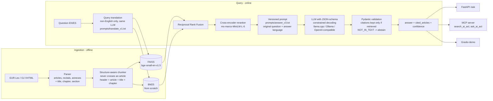

# AI Act RAG

Question answering over the **EU Artificial Intelligence Act** (Regulation (EU) 2024/1689)
with **article-level citations**, running **fully local on CPU** with free models, and an
evaluation set that measures retrieval, citations, abstention, faithfulness and latency.

## Key results

Default configuration: **Qwen2.5-3B-Instruct** (4-bit `Q4_K_M` GGUF file run by llama.cpp
on 4 CPU cores) + prompt v3 + hybrid retrieval with a reranker + query translation, scored
on 40 hand-labelled questions (32 answerable, 8 not answerable from the text).
Qwen2.5-1.5B-Instruct is the faster option.

| Metric | Default (3B, v3) | Fast (1.5B, v3) | Fast (1.5B, v2) |
|---|---|---|---|
| Gold article in the context given to the LLM | 100.0% | 100.0% | 100.0% |
| Correct citation (32 answerable) | 90.6% | 84.4% | 78.1% |
| Correct "not in text" (8 unanswerable) | 100.0% | 50.0% | 50.0% |
| False "not in text" (refuses an answerable question) | 0.0% | 0.0% | 0.0% |
| Yes/No correct (7 yes/no questions) | 85.7% | 71.4% | 71.4% |
| Key facts (figures of the reference kept, 12 questions) | 69.4% | 44.4% | 52.8% |
| p50 latency per question | 19.4 s | 13.9 s | 13.7 s |

- **Retrieval is solved for this set; generation is the bottleneck.** The cross-encoder
  reranker lifts Hit@5 from 78.1% (hybrid) to 90.6%, and translating Spanish queries brings
  the gold unit into the context for every question. The remaining errors are the model
  citing a neighbouring article or recital, answering an out-of-scope question (1.5B) or
  getting the polarity of a yes/no answer wrong.
- **3B + prompt v3 is the default** because it is the only run with both 100.0% correct and
  0.0% false "not in text", and it has the best correct citation. The 1.5B is ~5.5 s faster
  at p50 but gets only half of the out-of-scope questions right (50.0%). Switch with
  `AIACT_LLM_MODEL=models/qwen2.5-1.5b-instruct-q4_k_m.gguf` (and `AIACT_PROMPT_VERSION=v2`
  to keep more figures: key facts 52.8% vs 44.4%).
- **Read with care:** 40 questions (one answerable question ≈ 3.1 points, one yes/no
  question ≈ 14.3), and prompts v2 and v3 were both revised on this same set, v3 after an
  error analysis of these questions, so v3 numbers are optimistic. The correctness checks
  cover yes/no polarity and figures only (see [Limitations](#limitations)).

Full tables: [Results](#results). Raw answers for every question and run:
[`eval/results/answers_*.json`](eval/results/). To try it: [Run it in 3 commands](#run-it-in-3-commands).

## What an answer looks like

Recorded answers of the default configuration (questions q28, q36 and q30, from
`eval/results/answers_qwen2.5-3b_v3.json`), in the shape printed by `ai-act-rag ask`:

```text
$ uv run ai-act-rag ask "¿Qué multas se aplican por incumplir la prohibición de las prácticas de IA del artículo 5?"
{
  "answer": "Las multas por incumplir la prohibición de las prácticas de IA del artículo 5 son de hasta 35 000 000 de euros o el 7 % del total anual de ingresos de la empresa del año anterior, lo cual sea mayor.",
  "cited_articles": ["Article 99"],
  "confidence": "high",
  "abstained": false,
  ...
}

$ uv run ai-act-rag ask "What is the annual budget in euros allocated to each national AI regulatory sandbox?"
{
  "answer": "Not stated in the text of the AI Act (Regulation (EU) 2024/1689).",
  "cited_articles": [],
  "confidence": "low",
  "abstained": true,
  ...
}

$ uv run ai-act-rag ask "¿Está permitido usar sistemas de IA para inferir las emociones de los trabajadores en el lugar de trabajo?"
{
  "answer": "No",
  "cited_articles": ["Article 5"],
  "confidence": "medium",
  "abstained": false,
  ...
}
```

The Spanish questions are translated to English for retrieval and answered in Spanish; the
amounts come from Article 99. The last answer is right and cites the right article, but it
is a bare "No": prompt v3 makes both models answer yes/no questions with one word (see
[Limitations](#limitations)).
The JSON also has `question`, `latency_ms` and `parse_error` (elided here as `...`), and a
`Sources:` line after it lists the ids of the chunks given to the LLM (e.g. `Article 5#5`).

## The problem

The AI Act is ~84k words: 113 articles, 180 recitals and 13 annexes. Questions such as
*"is emotion recognition at work allowed?"* or *"how long must logs be kept?"* have exact
answers buried in one paragraph, and in legal work an answer without a source is worthless.
The goal is an assistant that:

1. answers **only** from the official text, **citing the articles** it relies on;
2. says **"not stated in the text"** instead of guessing when the Regulation is silent;
3. is **measured**: retrieval quality, citation accuracy, abstention, faithfulness and latency
   come from an evaluation set, not from impressions.

Everything is free: no paid API, no key, a 3B-parameter model (1.5B for speed) on a
laptop-class CPU.

## Architecture



In one sentence per stage: **BM25** (keyword scoring) and a **dense** embedder (semantic
similarity) each rank the chunks; **Reciprocal Rank Fusion (RRF)** merges the two rankings
using ranks only; a **cross-encoder** (a small model that reads question and passage
together) re-scores the top candidates; the LLM's output is **constrained** to the JSON
schema of the answer, so a small model cannot return free text.

Code layout (a pragmatic hexagonal architecture - dependencies point inwards; details in
[`docs/architecture.md`](docs/architecture.md)):

| Layer | Folder | What lives there |
|---|---|---|
| Domain | `src/ai_act_rag/domain/` | Pydantic models (`LegalUnit`, `Chunk`, `Answer`), ports as `typing.Protocol` (`Embedder`, `Retriever`, `Reranker`, `LLM`), exceptions. No dependencies. |
| Application | `src/ai_act_rag/application/` | Pure Python: chunking, BM25, RRF/hybrid retrieval, query translation, prompts, the `AnswerService` use case. |
| Infrastructure | `src/ai_act_rag/infrastructure/` | EUR-Lex parser, sentence-transformers, FAISS store, LLM providers, settings, FastAPI, MCP, Gradio, `container.py` (wiring). |
| Evaluation | `src/ai_act_rag/evaluation/` | Metrics (pure functions), runners, report generator. |

## Evaluation methodology

**The question set.** [`eval/questions.jsonl`](eval/questions.jsonl) has 40 questions written
by reading the Regulation; every gold label was checked against the text.

- **32 answerable / 8 unanswerable.** The unanswerable ones are mostly off-topic (corporate
  tax, GDPR fines, AI Office headcount, minimum salaries) plus near-misses that sound like
  something the Act would regulate but does not quantify: a euro budget per regulatory
  sandbox, a renewable-energy percentage for data centres.
- **32 English / 8 Spanish** (5 answerable, 3 unanswerable). Some Spanish questions are
  translations of English ones (fines under Article 99, date of application, emotion
  recognition at work), which isolates the cross-lingual effect.
- **`gold_units` = every unit that fully answers the question**, and retrieval is scored with
  Hit@k: finding any acceptable unit counts. A label audit added the second unit where the
  text answers in two places: Recital 179 restates the application dates of Article 113, and
  the content of technical documentation is set by Article 11 together with Annex IV.

**Metrics** (code in [`metrics.py`](src/ai_act_rag/evaluation/metrics.py),
[`runner.py`](src/ai_act_rag/evaluation/runner.py)):

- **Hit@k** - share of answerable questions with at least one gold unit among the top-k
  distinct units (article / annex / recital) retrieved. **MRR@10** (mean reciprocal rank) -
  average of 1/rank of the first gold unit within the top 10 units (1.0 = always first).
- **Gold in LLM context** - share of answerable questions where a gold unit is inside the
  `top_k` chunks the LLM actually sees. It can be lower than Hit@5, because Hit@k counts
  distinct units while several context chunks may come from the same unit.
- **Correct citation** - share of the 32 answerable questions whose answer cites at least one
  gold unit (abstentions and parse errors count as misses). It does **not** check that the
  answer text is right.
- **Citation precision / recall (answered)** - over answerable questions the system did answer:
  cited gold units / cited units, and cited gold units / gold units.
- **Correct 'not in text'** - deliberate abstentions on the 8 unanswerable questions (higher is
  better). **False 'not in text'** - abstentions on answerable questions, parse errors included
  (lower is better).
- **Parse errors** - share of all 40 questions whose LLM output was not valid JSON for the
  schema. The user sees "not stated in the text", but it is **never** counted as a correct
  abstention.
- **Yes/No correct** - over the 7 answerable questions whose reference answer starts with
  "Yes"/"No" ("Sí"/"No"), share whose answer starts with the same word. An abstention or a
  parse error counts as wrong.
- **Key facts** - over the 12 answerable questions whose reference answer states numbers
  (amounts, percentages, days, dates), the average share of those numbers that appear in the
  answer; numbers inside parenthesised citations such as "(Art. 99(3))" are excluded.
  Abstentions and parse errors score 0. Both checks were added after the v2 runs and applied
  to every stored run offline with `ai-act-rag rescore` (no LLM call; the other metrics are
  unchanged), see [`DECISIONS.md`](DECISIONS.md) D13.
- **Faithfulness (EN)** - share of answer sentences with >= 60% of their content words present
  in the **cited** passages (lexical, deterministic). An answer that cites nothing scores 0,
  and so does a one-word "Yes"/"No". English answers only, since the corpus is English.
- **Numbers grounded** - share of numbers in the answer (amounts, %, days, dates) that appear
  in the retrieved context; language-independent.
- **Latency** - wall-clock per question (translation + retrieval + reranking + generation),
  mean and p50, on 4 CPU cores.

**Caveats.** There is no dev/test split. Prompt v2 was revised once after a diagnostic run on
this same set (generic fixes, D10), and prompt v3 was written after the error analysis of
the v2 runs on these same 40 questions, together with the two correctness checks (D13):
v2 and especially v3 numbers are optimistic, and v3's Yes/No gain most of all, since its
yes/no rule targets exactly the questions that metric scores. One answerable question moves
a metric by ≈ 3.1 points (32 questions), one unanswerable question by 12.5 points (8), one
yes/no question by ≈ 14.3 points (7), one key-facts question by ≈ 8.3 points (12) and one
answerable Spanish question by 20.0 points of Hit@5 ES (5); the set is good for comparing
configurations, not for tight confidence intervals.

## Results

The tables below are generated by `uv run ai-act-rag report` from the JSON files in
[`eval/results/`](eval/results/); the commentary after them quotes those tables.

<!-- RESULTS:START -->
### Retrieval (32 answerable questions, unit-level Hit@k)

| Embedder | Chunk words | Retriever | Hit@1 | Hit@3 | Hit@5 | Hit@10 | MRR@10 | Gold in LLM context (top-5 chunks) | Hit@5 EN | Hit@5 ES | ms/query |
|---|---|---|---|---|---|---|---|---|---|---|---|
| bge-small-en-v1.5 | 150 | bm25 | 46.9% | 75.0% | 81.2% | 87.5% | 0.622 | 78.1% | 92.6% | 20.0% | 1 |
| bge-small-en-v1.5 | 150 | dense | 50.0% | 65.6% | 71.9% | 78.1% | 0.603 | 68.8% | 81.5% | 20.0% | 13 |
| bge-small-en-v1.5 | 150 | hybrid | 56.2% | 75.0% | 78.1% | 87.5% | 0.672 | 78.1% | 88.9% | 20.0% | 15 |
| bge-small-en-v1.5 | 150 | hybrid+rerank | 56.2% | 84.4% | 90.6% | 90.6% | 0.719 | 90.6% | 100.0% | 40.0% | 515 |
| bge-small-en-v1.5 | 150 | hybrid+rerank+translate | 71.9% | 100.0% | 100.0% | 100.0% | 0.859 | 100.0% | 100.0% | 100.0% | 747 |
| bge-small-en-v1.5 | 400 | bm25 | 37.5% | 71.9% | 78.1% | 81.2% | 0.559 | 75.0% | 92.6% | 0.0% | 1 |
| bge-small-en-v1.5 | 400 | dense | 46.9% | 65.6% | 68.8% | 78.1% | 0.582 | 68.8% | 77.8% | 20.0% | 15 |
| bge-small-en-v1.5 | 400 | hybrid | 53.1% | 71.9% | 71.9% | 84.4% | 0.637 | 71.9% | 81.5% | 20.0% | 15 |
| bge-small-en-v1.5 | 400 | hybrid+rerank | 50.0% | 75.0% | 81.2% | 87.5% | 0.648 | 81.2% | 92.6% | 20.0% | 1270 |
| bge-small-en-v1.5 | 400 | hybrid+rerank+translate | 56.2% | 84.4% | 87.5% | 100.0% | 0.727 | 87.5% | 92.6% | 60.0% | 1509 |
| paraphrase-multilingual-MiniLM-L12-v2 | 150 | bm25 | 46.9% | 75.0% | 81.2% | 87.5% | 0.622 | 78.1% | 92.6% | 20.0% | 1 |
| paraphrase-multilingual-MiniLM-L12-v2 | 150 | dense | 40.6% | 50.0% | 62.5% | 75.0% | 0.492 | 56.2% | 63.0% | 60.0% | 14 |
| paraphrase-multilingual-MiniLM-L12-v2 | 150 | hybrid | 43.8% | 59.4% | 75.0% | 93.8% | 0.568 | 68.8% | 77.8% | 60.0% | 15 |
| paraphrase-multilingual-MiniLM-L12-v2 | 150 | hybrid+rerank | 59.4% | 90.6% | 90.6% | 93.8% | 0.748 | 90.6% | 100.0% | 40.0% | 521 |
| paraphrase-multilingual-MiniLM-L12-v2 | 150 | hybrid+rerank+translate | 75.0% | 100.0% | 100.0% | 100.0% | 0.875 | 100.0% | 100.0% | 100.0% | 755 |
| paraphrase-multilingual-MiniLM-L12-v2 | 400 | bm25 | 37.5% | 71.9% | 78.1% | 81.2% | 0.559 | 75.0% | 92.6% | 0.0% | 1 |
| paraphrase-multilingual-MiniLM-L12-v2 | 400 | dense | 6.2% | 12.5% | 15.6% | 21.9% | 0.103 | 15.6% | 18.5% | 0.0% | 12 |
| paraphrase-multilingual-MiniLM-L12-v2 | 400 | hybrid | 12.5% | 21.9% | 43.8% | 75.0% | 0.254 | 43.8% | 51.9% | 0.0% | 12 |
| paraphrase-multilingual-MiniLM-L12-v2 | 400 | hybrid+rerank | 50.0% | 71.9% | 78.1% | 87.5% | 0.630 | 78.1% | 85.2% | 40.0% | 1224 |
| paraphrase-multilingual-MiniLM-L12-v2 | 400 | hybrid+rerank+translate | 56.2% | 78.1% | 81.2% | 96.9% | 0.699 | 81.2% | 85.2% | 60.0% | 1530 |

_Run 2026-11-25T23:11:58+00:00 on 4 CPU cores, Python 3.13.18._

### End-to-end answers (32 answerable questions, 8 not answerable from the text)

| LLM | Prompt | Retrieval | Correct citation | Citation precision (answered) | Citation recall (answered) | Correct 'not in text' | False 'not in text' | Parse errors | Yes/No correct | Key facts | Faithfulness (EN) | Numbers grounded | Latency mean (s) | Latency p50 (s) |
|---|---|---|---|---|---|---|---|---|---|---|---|---|---|---|
| qwen2.5-1.5b-instruct-q4_k_m.gguf | v2 | hybrid+rerank | 71.9% | 57.9% | 71.0% | 50.0% | 3.1% | 0.0% | 71.4% | 40.3% | 96.3% | 100.0% | 14.6 | 12.0 |
| qwen2.5-1.5b-instruct-q4_k_m.gguf | v1 | hybrid+rerank+translate | 75.0% | 47.0% | 71.0% | 50.0% | 3.1% | 2.5% | 57.1% | 69.4% | 69.2% | 100.0% | 14.2 | 11.8 |
| qwen2.5-1.5b-instruct-q4_k_m.gguf | v2 | hybrid+rerank+translate | 78.1% | 59.2% | 75.0% | 50.0% | 0.0% | 0.0% | 71.4% | 52.8% | 96.3% | 100.0% | 14.6 | 13.7 |
| qwen2.5-1.5b-instruct-q4_k_m.gguf | v3 | hybrid+rerank+translate | 84.4% | 62.6% | 79.7% | 50.0% | 0.0% | 2.5% | 71.4% | 44.4% | 74.1% | 96.1% | 16.3 | 13.9 |
| qwen2.5-3b-instruct-q4_k_m.gguf | v1 | hybrid+rerank+translate | 87.5% | 55.7% | 81.2% | 25.0% | 0.0% | 0.0% | 85.7% | 77.8% | 80.2% | 93.8% | 26.6 | 22.4 |
| qwen2.5-3b-instruct-q4_k_m.gguf | v2 | hybrid+rerank+translate | 81.2% | 73.0% | 88.9% | 100.0% | 15.6% | 0.0% | 14.3% | 65.3% | 95.7% | 98.8% | 25.5 | 26.9 |
| qwen2.5-3b-instruct-q4_k_m.gguf | v3 | hybrid+rerank+translate | 90.6% | 66.4% | 84.4% | 100.0% | 0.0% | 0.0% | 85.7% | 69.4% | 77.8% | 100.0% | 21.9 | 19.4 |

_llama_cpp, temperature 0, top-k = 5 chunks of 150 words; run on 4 CPU cores._
<!-- RESULTS:END -->

### What the numbers say

- **Retrieval, default embedder (bge-small-en-v1.5, 150 words).** Dense alone is the weakest
  (Hit@5 71.9%, MRR@10 0.603); BM25 does better on legal vocabulary (81.2%, 0.622). RRF fusion
  lifts MRR@10 to 0.672 but its Hit@5 (78.1%) sits between the two. The cross-encoder is what
  moves the top of the list: Hit@5 90.6%, MRR@10 0.719 and gold in the LLM context 90.6%
  (78.1% for hybrid), at 515 ms/query instead of 15.
- **Spanish needs query translation.** Without it Hit@5 ES is 20.0% for BM25, dense and hybrid,
  and 40.0% with the reranker. Translating the query gives Hit@5 ES 100.0%, gold in context
  100.0% and MRR@10 0.859. Only 5 answerable questions are Spanish, so these columns are
  indicative.
- **150 vs 400 words.** The 150-word chunks win on Hit@5 and MRR@10 in every bge-small row
  (hybrid+rerank: Hit@5 90.6% vs 81.2%, MRR@10 0.719 vs 0.648), and the reranker is cheaper
  on shorter passages (515 vs 1270 ms/query).
- **Multilingual paraphrase model.** Dense-only at 400 words it collapses (Hit@5 15.6%, MRR@10
  0.103): it is trained for sentence similarity and truncates long chunks. At 150 words, once
  fused and reranked, it is comparable to bge-small (Hit@5 90.6% for both, MRR@10 0.748 vs
  0.719; with translation 0.875 vs 0.859), a gap of about one question.
- **Prompt v1 vs v2 (1.5B, translation on).** Correct citation barely moves (75.0% vs 78.1%,
  one question); the gains are citation precision (47.0% -> 59.2%), faithfulness (EN)
  (69.2% -> 96.3%), parse errors (2.5% -> 0.0%) and false 'not in text' (3.1% -> 0.0%).
- **Translation ablation (1.5B, v2).** Turning translation off drops correct citation from
  78.1% to 71.9% and brings back 3 retrieval misses (q28, q29, q30, all Spanish), one of them
  a false 'not in text' (3.1%). The cost is p50 latency 13.7 s vs 12.0 s.
- **1.5B vs 3B (v2, translation on).** The 3B cites a little more often (81.2% vs 78.1%) and
  much more precisely (precision 73.0% vs 59.2%, recall 88.9% vs 75.0%) and abstains on every
  unanswerable question (100.0% vs 50.0%), but refuses 5 answerable ones (false 'not in text'
  15.6% vs 0.0%: q06, q07, q11, q12, q30) and its p50 latency is 26.9 s vs 13.7 s. With
  prompt v1 the 3B reaches 87.5% correct citation but abstains on only 25.0% of the
  unanswerable questions.
- **What the correctness columns revealed.** "Correct citation" checks the cited article, not
  the answer. Scoring polarity and figures against the reference answers showed two opposite
  failures on the 7 yes/no questions: the 3B with v2 answered "not in the text" on 5 of them
  (all five of its false refusals are yes/no questions whose passage prohibits or excludes
  the thing asked about) and did not start a sixth with "Yes" (Yes/No correct 14.3%), while
  the 1.5B answered "Yes" to scraping
  facial images for a recognition database (q07), a practice Article 5 prohibits, and to the
  Act applying to military uses (q11), which Article 2 excludes, both with the right citation.
  Key facts shows how many reference figures survive: 3B v1 keeps the most (77.8%), the 1.5B
  with v2 about half (52.8%).
- **Prompt v3 (written from that analysis).** It adds a yes/no rule, moves the worked example
  to an unrelated topic and asks to keep exact figures. On the 3B it removes the false
  refusals (false 'not in text' 15.6% -> 0.0%) without losing abstention (100.0%), lifts
  Yes/No correct from 14.3% to 85.7% and correct citation from 81.2% to 90.6%, and cuts p50
  latency from 26.9 s to 19.4 s with shorter answers. On the 1.5B it raises correct citation
  (78.1% -> 84.4%) but lowers key facts (52.8% -> 44.4%), faithfulness (EN) (96.3% -> 74.1%)
  and numbers grounded (100.0% -> 96.1%), adds one parse error (q40, 2.5%), leaves Yes/No
  correct at 71.4% (still "Yes" to q07 and q11) and still gets only 4 of the 8 unanswerable
  questions right (50.0%: it answers q34, q35 and q37, and q40 is the parse error).
- **Why faithfulness drops with v3.** v3 makes both models answer all 7 yes/no questions
  with a bare "Yes"/"No", which has no content words and scores 0 on the lexical metric. In
  the records, leaving out the 6 English bare yes/no answers, the 3B v3's other English
  answers score 100% and the 1.5B v3's 95.2%. The 3B's answers are also terser overall
  (36.5 vs 61.9 words per answered English question with v2; it gives three figure
  questions just the figure, e.g. "15 days"); the 1.5B's are not (52.1 vs 47.0 words).
- **Where the errors come from.** With translation every run has 0 retrieval misses: the gold
  unit is always in the context, so the remaining errors are generation. For the default run
  (3B, v3) that means 3 generation misses (q12 cites Recitals 25 and 97 instead of Article 2,
  q22 Recital 106 instead of Article 53, q25 Article 99 instead of Article 100), no false
  'not in text' and no unanswerable question answered. Its only yes/no error is q07: a bare
  "Yes" with Article 5 cited.

## Error analysis

`ai-act-rag report` also writes [`eval/results/summary.md`](eval/results/summary.md), which
attributes every failed question of every run to one stage of the pipeline, with the question
ids so each case can be read in the `answers_*.json` file:

| Failure | Rule |
|---|---|
| Retrieval miss | answerable, no gold unit in the context given to the LLM |
| Generation miss | gold unit in the context, the answer does not cite it |
| False 'not in text' | gold unit in the context, the model abstained |
| Unparseable output | the LLM output could not be parsed (any question) |
| Hallucination | unanswerable question answered anyway |

This separates "fix retrieval" from "fix the prompt or the model" before changing anything.

## Trade-offs

| Choice | Cost | Benefit |
|---|---|---|
| Qwen2.5 3B (default) instead of 1.5B (both v3) | p50 19.4 s vs 13.9 s; ~1.9 GB vs ~1 GB GGUF | correct 'not in text' 100.0% vs 50.0%, correct citation 90.6% vs 84.4%, Yes/No correct 85.7% vs 71.4%, key facts 69.4% vs 44.4% |
| Prompt v3 (default) instead of v2 (3B) | bare "Yes"/"No" answers; faithfulness (EN) 77.8% vs 95.7%, citation precision 66.4% vs 73.0%, recall 84.4% vs 88.9% | false 'not in text' 0.0% vs 15.6%, Yes/No correct 85.7% vs 14.3%, correct citation 90.6% vs 81.2%, key facts 69.4% vs 65.3% |
| Cross-encoder reranker | 515 ms/query vs 15 for hybrid (bge-small, 150 words) | Hit@5 90.6% vs 78.1%, MRR@10 0.719 vs 0.672 |
| Query translation (on by default) | one extra short LLM call for non-English questions (1.5B v2: p50 13.7 s vs 12.0 s) | correct citation 78.1% vs 71.9%, without indexing the Spanish text (double index, citation mapping) or switching embedder |
| Constrained decoding | needs grammar support in the runtime (llama.cpp schema, Ollama `format`) | valid JSON from a small model; the OpenAI-compatible path falls back to `json_object` mode + Pydantic validation |

## Run it in 3 commands

Requires [uv](https://docs.astral.sh/uv/) and ~10 GB of disk on Linux (`.venv` with PyTorch
~6 GB, models ~3.6 GB: the 3B GGUF ~1.9 GB, the 1.5B GGUF ~1 GB, embedders and reranker
~0.7 GB; `MODEL_SOURCE=dockerhub` also keeps the 3.1 GB F16 file the 1.5B is quantised from).
`scripts/download_models.py` fetches both GGUFs; `--llm 3b` fetches only the default.

```bash
uv sync --all-extras                 # 1. install (Python 3.12+, pinned versions, uv.lock)
./scripts/bootstrap.sh               # 2. download AI Act + models, build the index
uv run ai-act-rag ask "¿Está prohibido el reconocimiento de emociones en el trabajo?"   # 3. ask
```

Non-English questions are translated to English for retrieval and answered in their own
language; `AIACT_TRANSLATE_QUERIES=0` turns this off (default on). For faster answers use the
1.5B: `AIACT_LLM_MODEL=models/qwen2.5-1.5b-instruct-q4_k_m.gguf` (see
[Key results](#key-results) for what it costs).

Other entry points:

```bash
uv run uvicorn ai_act_rag.infrastructure.api:app      # REST API on :8000 (docs at /docs)
uv run python -m ai_act_rag.infrastructure.mcp_server # MCP server (stdio): search_ai_act, ask_ai_act
uv run python -m ai_act_rag.infrastructure.demo       # Gradio demo on :7860
docker build -t ai-act-rag . && docker run -p 8000:8000 \
  -v $PWD/data:/app/data -v $PWD/models:/app/models ai-act-rag
```

- **API usage.** The models load before the port opens (a minute or more on 4 cores), then:
  `curl localhost:8000/health`,
  `curl -X POST localhost:8000/ask -H 'Content-Type: application/json' -d '{"question": "How long must logs be kept?"}'`
  (answer, citations, the context passages and `latency_ms`) and
  `curl 'localhost:8000/search?q=emotion+recognition&k=3'` (passages only, no answer).
- **API behaviour.** It starts even if the index or model is missing: `GET /health` returns
  `ready: false` and `/ask` / `/search` answer 503 with the reason. llama.cpp is not
  thread-safe, so requests are served one at a time; a request that waits more than 120 s
  gets a 503 "busy".
- **Docker.** The image runs as a non-root user (uid 1000), so the mounted `data/` and
  `models/` must be world-readable (`chmod -R a+rX data models`). `torch` comes from PyPI with
  CUDA libraries, so the CPU image is several GB (see [Future work](#future-work)). CI builds
  the Dockerfile on every push to `main` and every pull request; the build, `/health` and one
  `POST /ask` were also checked by hand with a variant of the Dockerfile adapted to a network without apt/ghcr access.

Reproduce every table (CPU-heavy; needs `bootstrap.sh` first, and the 3B GGUF for the 3B rows):

```bash
./scripts/run_all_evals.sh   # retrieval grid, answer runs + ablation, then `ai-act-rag report`
```

Switch provider with environment variables (see [`.env.example`](.env.example)):

```bash
AIACT_LLM_PROVIDER=ollama AIACT_LLM_MODEL=qwen2.5:3b uv run ai-act-rag ask "..."
AIACT_LLM_PROVIDER=openai AIACT_OPENAI_API_KEY=... AIACT_LLM_MODEL=llama-3.1-8b-instant uv run ai-act-rag ask "..."
```

To use it from any MCP client (desktop assistants, IDEs), register the server in the client's config:

```json
{"mcpServers": {"ai-act": {"command": "uv", "args": ["--directory", "/path/to/ai-act-rag",
  "run", "python", "-m", "ai_act_rag.infrastructure.mcp_server"]}}}
```

## How to extend

- **New LLM provider.** Write a class in `src/ai_act_rag/infrastructure/llm/` with a `name`
  property and `generate(system, user, json_schema=None, max_tokens=512) -> str` (the `LLM`
  `Protocol` in `domain/ports.py`; no inheritance needed), then add a branch for it in
  `container.build_llm` keyed on `AIACT_LLM_PROVIDER`.
- **New prompt version.** Add `prompts/answer_vN.txt` (`### system` / `### user` sections,
  `{context}`, `{question}`, `{language}` placeholders), compare it with
  `uv run ai-act-rag eval-answers --prompts v2 vN --tag <label>` and `uv run ai-act-rag report`,
  and select it with `AIACT_PROMPT_VERSION=vN`.
- **New questions.** Append lines to `eval/questions.jsonl`:
  `{"id", "lang", "question", "gold_units", "answerable", "reference_answer"}`, with
  `gold_units` listing every unit that fully answers the question (empty if unanswerable).
  If only labels change, `uv run ai-act-rag rescore` re-applies them to stored runs without
  calling the LLM again.
- **New embedder.** Set `AIACT_EMBEDDING_MODEL` and rebuild with `uv run ai-act-rag build-index`.
  The index stores the embedder name and chunk size in `meta.json` and refuses to load with a
  mismatching embedder or `AIACT_CHUNK_WORDS`. Add it to the grid with
  `eval-retrieval --embedding-models ...`.

## Design decisions

The full log, with context and consequences, is in [`DECISIONS.md`](DECISIONS.md). In short:

- **Parse the structure, don't regex plain text.** The Official Journal XHTML tags every
  unit (`art_5`, `rct_29`, `anx_III`, `cpt_II`), so article numbers, titles, chapters and
  sections are exact; list labels (`(a)`, `(b)`) and exponents (`10^25` FLOPs, not `1025`)
  survive, footnote markers do not.
- **Chunks never cross an article** and carry a header
  (`Article 5 - Prohibited AI practices | Chapter II - ...`), so a chunk read out of context
  still says where it comes from, for BM25, the embedder and the LLM.
- **Hybrid retrieval + reranker, chosen from the grid** (D06): BM25 and dense retrieval fail
  on different questions; RRF needs no score calibration. BM25 is written from scratch
  (~60 lines, unit-tested against the formula, D05).
- **Structured output** (D07): with llama.cpp the Pydantic schema is compiled into a grammar;
  Pydantic still validates, and unparseable output (e.g. cut by the token budget) is flagged
  as a parse error and shown as an abstention instead of crashing.
- **Citations restricted to the context** (D07): citations are normalised
  (`Art. 5(1)(f)` -> `Article 5`) and dropped unless that unit was retrieved, so the system
  never shows a citation it did not read. It does not prove the cited text supports the
  answer (see Limitations).
- **Explicit abstention**: the prompt defines a sentinel (`NOT_IN_TEXT`) that becomes a
  localised "Not stated in the text" / "No consta en el texto".
- **Versioned prompts** in [`prompts/`](prompts/), evaluated side by side: v1 baseline, v2
  strict grounding with a worked example on a topic outside the eval set (D10), v3 adding a
  yes/no rule and figure retention from the v2 error analysis (D13).
- **Query translation as a decorator** (D11): `TranslatingRetriever` wraps any retriever;
  generation still sees the original question, so the answer stays in the user's language.
- **Deterministic metrics** instead of an LLM judge as small and noisy as the model being
  judged: lexical faithfulness and number grounding (D09), plus yes/no polarity and key
  figures checked against the reference answers (D13).
- **Swappable providers behind ports** (D04): llama.cpp (default), Ollama and any
  OpenAI-compatible API implement the same `LLM` protocol; tests use a fake LLM and a fake
  embedder, so CI never downloads a model.
- **Reproducibility** (D03): exact pins + `uv.lock`, fixed seeds, greedy decoding (temperature
  0), SHA-256 of the source text recorded in the index; `ruff`, `mypy --strict` and `pytest`
  in CI, plus a Docker build.

## Limitations

- **Answer correctness is only partly scored.** Correct citation checks which unit is cited;
  Yes/No correct and Key facts check polarity (7 questions) and figures (12 questions)
  against the reference answers. Nothing checks the rest of an answer's content. Even the
  default (3B, v3) answers q07 with a bare "Yes" citing Article 5, which prohibits the
  practice asked about; with v2 the 1.5B does the same on q07 and q11 with fluent sentences
  that score faithfulness 1.0.
- **Bare yes/no answers.** With prompt v3 both models answer every yes/no question with one
  word ("Yes" or "No") plus the citation, although the prompt asks for complete sentences. Correct
  and cited, but curt for a user, and scored 0 by the lexical faithfulness metric.
- **Small models on CPU.** The 3B takes 19.4 s p50 per question on 4 cores; the 1.5B is
  faster but gets only half of the out-of-scope questions right and drops more figures.
- **Cross-lingual retrieval.** The corpus is the English text and the default embedder is
  English-only; query translation fixes retrieval on this set, but only 5 answerable questions
  are Spanish.
- **40 questions, no dev/test split** (see the methodology caveats): enough to compare
  configurations, not to claim tight confidence intervals.
- **Faithfulness is lexical**: paraphrased but correct answers can score lower, one-word
  answers score 0, a contradiction reusing the same words passes (q07 with the 1.5B and v2),
  and it is computed for English answers only.
- **One request at a time** in the API (llama.cpp is not thread-safe), at 19.4 s p50 per
  question on 4 cores: a demo, not a multi-user service.
- **Original text only**: amendments after 2024 (e.g. the 2026 "digital omnibus") are not
  included.
- **Build environment.** The environment where this was built could not reach EUR-Lex or
  Hugging Face, so the official OJ XHTML came from a hash-pinned copy vendored in a PyPI
  package and the models from Docker Hub (D01, D02). On a normal machine the scripts use
  EUR-Lex and Hugging Face. The 1.5B GGUF was quantised locally from the official F16 file and
  the 3B is Docker Hub's ready Q4_K_M artifact, so neither is known to be byte-identical to the
  Hugging Face Q4_K_M file and outputs may differ slightly.
  The published results were produced with Python 3.13; CI and Docker use Python 3.12.

## Future work

In rough order of expected value:

1. **Score the rest of answer correctness.** Yes/no polarity and figures are checked; for the
   rest, label a subset of answers by hand (correct / partially / wrong against
   `reference_answer`), then calibrate an LLM judge (a larger model than the one being
   judged) on that subset before trusting it on the rest.
2. **Larger eval set with a dev/test split**, so prompt changes are tuned on dev and reported
   on test, with bootstrap confidence intervals. v3 in particular needs confirming on
   questions it was not written from.
3. **Prompt v4**: keep v3's yes/no rule but require a justifying sentence after "Yes"/"No"
   (and after a bare figure), then re-check q07.
4. **Abstention for the 1.5B**: a retrieval-score threshold or a short "is this answered by the
   passages?" check before generation, to close its 50.0% vs 100.0% gap with the 3B at the
   1.5B's speed.
5. **Native Spanish retrieval**: index the Spanish version of the Regulation (same unit ids,
   so citations map 1:1) or use a retrieval-trained multilingual embedder such as
   `intfloat/multilingual-e5-small`, and drop the translation call.
6. **Serving**: CPU-only `torch` wheel in the Docker image, streaming answers, and an
   inference server (llama.cpp server or Ollama) instead of a lock around one in-process model.

## Development

```bash
uv sync --all-extras
uv run pytest                     # unit tests (fake LLM + fake embedder, no downloads)
uv run ruff check . && uv run ruff format --check . && uv run mypy
```

## Resumen en español

Asistente RAG que responde preguntas sobre el **Reglamento Europeo de Inteligencia Artificial
(Reglamento (UE) 2024/1689)** citando los artículos en los que se basa, y que contesta
**"No consta en el texto"** cuando el Reglamento no dice nada al respecto. Todo es gratuito y
local: el texto oficial del DOUE se parsea por artículos, considerandos y anexos, se trocea
sin mezclar artículos y se recupera con búsqueda híbrida (BM25 propio + embeddings densos con
FAISS, fusionados con Reciprocal Rank Fusion y reordenados con un cross-encoder). Las
preguntas en español se traducen al inglés solo para la búsqueda y se responden en español.
Un Qwen2.5-3B cuantizado (o un 1.5B, más rápido) corre en CPU con llama.cpp y genera JSON
validado con Pydantic, con decodificación restringida por esquema. Hay API REST (FastAPI), servidor MCP y demo
(Gradio).

**Resultados** (40 preguntas: 32 con respuesta y 8 sin ella; 32 en inglés y 8 en español).
Con la configuración por defecto (3B + prompt v3 + traducción) el artículo correcto está
siempre en el contexto (100.0%), las citas son correctas en el 90.6% de las preguntas con
respuesta, detecta todas las preguntas sin respuesta (100.0%) sin negarse a responder
ninguna válida (0.0%), acierta el sentido (sí/no) en el 85.7% de las 7 preguntas de sí o no y
conserva el 69.4% de las cifras de las respuestas de referencia, con una latencia p50 de
19.4 s en 4 núcleos. El 1.5B es la opción rápida (p50 13.9 s con v3): cita bien el 84.4%,
pero solo detecta la mitad de las preguntas sin respuesta (50.0%) y conserva menos cifras (44.4%
con v3, 52.8% con v2). Las métricas de corrección (sí/no y cifras clave) revelaron que con el
prompt v2 el 3B se negaba a responder preguntas de sí o no sobre prácticas prohibidas o
excluidas (sí/no correcto: 14.3%) y el 1.5B respondía "Yes" a una práctica prohibida (q07)
citando el artículo correcto;
el prompt v3 nació de ese análisis.

**Limitaciones y siguientes pasos.** El conjunto es pequeño y sin partición dev/test: los
prompts v2 y v3 se ajustaron sobre estas mismas 40 preguntas (v3 tras analizar sus errores),
así que sus cifras, sobre todo las de v3, son optimistas. La corrección solo se mide en
polaridad y cifras; el 3B con v3 sigue respondiendo "Yes" a la q07, y con v3 ambos modelos
contestan las preguntas de sí o no con una sola palabra, lo que además baja la fidelidad
léxica (77.8% frente a 95.7% del 3B con v2). Siguientes pasos: un juez LLM calibrado sobre
un subconjunto etiquetado a mano, más preguntas con partición dev/test, un prompt v4 que
exija justificar el sí/no, mejorar la abstención del 1.5B, indexar el texto en español (o
usar multilingual-e5) y servir con streaming y una imagen Docker más ligera. Todas las
cifras salen de `eval/results/`.

## License

[MIT](LICENSE). The AI Act text is © European Union, reused under the EUR-Lex reuse policy
(Commission Decision 2011/833/EU); it is downloaded by the scripts, not redistributed here.
